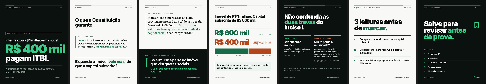

# Sistema visual NEXO Fiscal para Instagram

**Lei seca à esquerda. Tradução direta à direita.**

O DNA que já existia nos posts virou regra de sistema: o texto literal tem cara de documento, a tradução tem cara de voz da marca, e todo slide responde a uma pergunta de prova.

Caso-piloto: carrossel e stories do **Tema 796 do STF** (ITBI na integralização de capital).

> Versão visual deste documento, com galerias e vídeos: [`docs/report/index.html`](report/index.html) (abra no navegador ou publique via GitHub Pages).

---

## 1. Diagnóstico dos anexos

Fontes analisadas: Carrossel #01 (Tema 796, 4 slides), slide 02 da SV 31, stories V01–V03 (Desafio ITBI, decadência, metodologia).

| Elemento | O que os anexos fazem | Decisão no sistema |
|---|---|---|
| Paleta | Fundo editorial claro, preto institucional, verde escuro em rótulos e destaques, verde vivo sobre o preto. Terracota só em “ITBI?” e “Incide ITBI”. | Mantida. Terracota vira cor **semântica** (incidência, erro, pegadinha), nunca decorativa. |
| Tipografia | Sans pesada nos títulos, serifada no texto literal, mono em metadados. | Inter 800–900 com tracking negativo; Noto Sans Mono em rótulos, numeração e fontes. Serifada **só** no texto literal de lei e tese. |
| Grid | Margens largas, mas conteúdo flutuando no meio com faixas vazias acima e abaixo. | 6 colunas, margem de 88 px, calha de 32 px. Espaço vazio intencional, ancorado em cima ou embaixo. |
| Destaques | Marca-texto verde-claro no literal; palavras-chave em verde vivo no bloco preto. | Componentes `Mark` e `Hl`; no máximo um destaque por bloco. |
| Boxes | Cartões brancos bem arredondados e com sombra; bloco preto “Sem juridiquês”. | Cantos de 0–4 px, sem sombra. O bloco preto segue como assinatura, em largura total. |
| Assinaturas | Rótulo mono sublinhado, paginação “02 / 04”, @ no rodapé, colchetes [ ] explicando a lei na linha. | Kit fixo: barra de progresso + rótulo + paginação; rodapé com @ + próxima ação; colchete como recurso gráfico. |
| Legibilidade | Rótulos com ~15 px em arte de 1080 px (~5 pt no celular). | Mínimo de 21 px em rótulos e 27–32 px em corpo; títulos de 76 a 232 px. |
| Copy | Capas descritivas; CTAs repetidos (“Veja o Mapa Visual”). | Capa com número concreto; cada rodapé anuncia o próximo slide; uma chamada final. |

**Riscos técnicos encontrados:** o selo “Regra Incondicionada” afirma mais do que a tese do Tema 796 diz; “mais de 70% dos candidatos confundem…” (V01) não tem fonte; há divergência entre 272 e 273 questões inéditas (V03). Ver seção 9.

---

## 2. Direção de arte

1. **Um número ou uma frase domina.** Cada slide tem um elemento lido em menos de 1 segundo.
2. **Claro e escuro alternam por função.** Escuro abre, mostra o erro e fecha; claro ensina e mostra dados.
3. **Lei em serifa, voz da marca em Inter.** O leitor sabe se está lendo a norma ou a tradução.
4. **Dados desenhados em escala.** Barras proporcionais reais (60/40, 25/75).
5. **Terracota só para o que custa ponto.** Incidência, pegadinha, erro.
6. **Sem decoração.** Nada de ícones, gradientes ou sombras sem função; os únicos ícones (salvar, link, seta) indicam ação.

### Paleta

| Token | Hex | Uso |
|---|---|---|
| `ink` | `#0B110E` | Preto institucional: fundo escuro, texto |
| `green` | `#176B49` | Verde institucional: rótulos e destaques no claro |
| `mint` | `#36CD89` | Verde de destaque: acentos no escuro |
| `paper` | `#F8F9F6` | Fundo editorial |
| `surface` | `#EDF3EE` | Superfícies, marca-texto |
| `line` | `#D8E1DA` | Divisórias |
| `alert` | `#B4441A` | Semântica: incide, erro, pegadinha |

Proporção no slide claro: 78% fundo · 12% preto · 7% verde · 3% destaque.
Proporção no slide escuro: 80% preto · 12% branco · 6% destaque · 2% terracota (só se houver incidência).

### Escala tipográfica (arte de 1080 px)

| Papel | Tamanho / peso | Família |
|---|---|---|
| Hero (número) | 194–232 / 900 | Inter |
| Display | 104 / 900 | Inter |
| H1 | 76 / 800 | Inter |
| H2 | 54 / 800 | Inter |
| Lead | 38 / 600 | Inter |
| Corpo | 32 / 500 | Inter |
| Lei e tese | 38–46 / 500 | Source Serif 4 |
| Rótulo | 21 / 600, caixa alta, tracking 0,12 em | Noto Sans Mono |

### Grid

- **Feed 1080 × 1350:** margem de 88 px; 6 colunas, calha de 32 px; barra de topo a 88 px; texto corrido com até ~38 caracteres por linha.
- **Stories 1080 × 1920:** conteúdo entre y = 250 e y = 1580 (perfil em cima, campo de resposta embaixo). Figurinhas em áreas reservadas, marcadas na versão guia.

---

## 3. Biblioteca de componentes e modelos

Código em [`src/ds/ui.tsx`](../src/ds/ui.tsx). Tokens em [`src/ds/tokens.ts`](../src/ds/tokens.ts).

| Componente | Função |
|---|---|
| `TopBar` | Barra que enche com a posição no carrossel + rótulo + paginação |
| `Footer` | @nexofiscalbr + próxima ação (nunca dois CTAs) |
| `Text` | Aplica a escala hero/display/h1/h2/lead/body/small |
| `Hl` / `Warn` | Destaque verde / destaque semântico terracota |
| `Law` / `Mark` | Texto literal com régua verde / marca-texto (anima nos stories) |
| `Br` | Tradução entre colchetes na mesma linha |
| `SplitBar` / `Stat` | Barra proporcional / número dominante com rótulo |
| `Tag`, `TemplateBadge`, `Icon` | Selo, aviso de modelo com dados fictícios, ícones de ação |

| # | Modelo | Aplicado em | Arquivo |
|---|---|---|---|
| 1 | Capa editorial | Carrossel 01A e 01B | `DS-T796-01A`, `DS-T796-01B` |
| 2 | Comparativo entre bancas | Modelo, dados a preencher | `DS-MODELO-comparativo-bancas` |
| 3 | Ranking de incidência | Modelo, dados a preencher | `DS-MODELO-ranking-incidencia` |
| 4 | Questão comentada | Questão inédita do V01 | `DS-QC-01`, `DS-QC-02` |
| 5 | Erro clássico | Carrossel 05 e SV 31 | `DS-T796-05`, `DS-SV31` |
| 6 | Mapa de revisão rápida | Carrossel 04 | `DS-T796-04` |
| 7 | Story com quiz | Story 2 | `DS-STORY-2-quiz` |
| 8 | Story de conteúdo | Stories 3 e 4 | `DS-STORY-3`, `DS-STORY-4` |
| 9 | Story de produto | Story 5 | `DS-STORY-5-conversao` |
| 10 | Card de conversão | Carrossel 07A e 07B | `DS-T796-07A`, `DS-T796-07B` |

---

## 4. Carrossel Tema 796

**Objetivo:** autoridade e salvamentos. É material de revisão; a conversão fica com os stories (figurinha de link).

| Slide | Função | Arquivo |
|---|---|---|
| 01A | Gancho (impacto editorial, prioritário) | [PNG](../exports/feed/DS-T796-01A-capa-impacto.png) |
| 01B | Gancho (curiosidade, variante A/B) | [PNG](../exports/feed/DS-T796-01B-capa-curiosidade.png) |
| 02 | Contextualização: a regra da CF | [PNG](../exports/feed/DS-T796-02-contexto.png) |
| 03 | Tese literal + tradução | [PNG](../exports/feed/DS-T796-03-tese.png) |
| 04 | Mapa de revisão: exemplo numérico | [PNG](../exports/feed/DS-T796-04-exemplo.png) |
| 05 | Erro clássico: duas travas | [PNG](../exports/feed/DS-T796-05-erro-classico.png) |
| 06 | Insight: 3 leituras antes de marcar | [PNG](../exports/feed/DS-T796-06-checklist.png) |
| 07A | Conversão: salvar | [PNG](../exports/feed/DS-T796-07A-cta-salvar.png) |
| 07B | Conversão: material (variante A/B) | [PNG](../exports/feed/DS-T796-07B-cta-produto.png) |

**Por que a 01A é a prioritária:** lê em um segundo, tem o único número que gera dúvida imediata (“por que 400?”) e repete o gancho que teve a maior nota no avaliador do `/ig-reel`. A 01B depende de o leitor saber que a CF não fixa limite.

---

## 5. Stories: sequência de conversão

Formato vertical nativo, animação curta (5–7 s), um objetivo por story, área livre para a figurinha nativa.

| Story | Objetivo | Figurinha | Vídeo | Guia |
|---|---|---|---|---|
| 1 · Interrupção | Pergunta com o número do caso | — | [MP4](../exports/stories/DS-STORY-1-interrupcao.mp4) | [PNG](../exports/stories/DS-STORY-1-interrupcao-guia.png) |
| 2 · Interação | “Incide ITBI sobre:” | Quiz (y 1110–1510; certa: R$ 1,5 milhão) | [MP4](../exports/stories/DS-STORY-2-quiz.mp4) | [PNG](../exports/stories/DS-STORY-2-quiz-guia.png) |
| 3 · Autoridade | Gabarito, barra 25/75, tese literal | — | [MP4](../exports/stories/DS-STORY-3-autoridade.mp4) | [PNG](../exports/stories/DS-STORY-3-autoridade-guia.png) |
| 4 · Desejo | Explicação entre colchetes na linha | — | [MP4](../exports/stories/DS-STORY-4-desejo.mp4) | [PNG](../exports/stories/DS-STORY-4-desejo-guia.png) |
| 5 · Conversão | 20 páginas reais do material | Link (y 1360–1510) | [MP4](../exports/stories/DS-STORY-5-conversao.mp4) | [PNG](../exports/stories/DS-STORY-5-conversao-guia.png) |

---

## 6. Demais peças

- **Questão comentada:** [enunciado](../exports/feed/DS-QC-01-enunciado.png) e [gabarito](../exports/feed/DS-QC-02-gabarito.png), com a questão inédita do V01 sem alterações.
- **Erro clássico · SV 31:** [PNG](../exports/feed/DS-SV31-erro-classico.png).
- **Modelos de dados:** [comparativo entre bancas](../exports/feed/DS-MODELO-comparativo-bancas.png) e [ranking de incidência](../exports/feed/DS-MODELO-ranking-incidencia.png). Saem com “00%”, campos entre chaves e um selo vermelho que impede publicar por engano. Para preencher: número de questões, provas, período e cargos do recorte, sempre na linha de fonte.

---

## 6.1 Motion: personagens e diálogo

Para vídeos de diálogo (ex.: [story do estudante](roteiros/story-estudante-bancas.md)), use `src/ds/characters.tsx`:

- `Person` (`student` | `mentor`): figuras planas em duas cores, sem sombra nem degradê. Estudante em cinza-verde (`mutedDark`), auditor em verde institucional com gola verde-destaque e óculos. Humor: `confused`, `neutral`, `surprised`, `happy`; `talking` anima a boca.
- `Bubble`: balão com cantos de 4 px e rabicho para quem fala; branco para o estudante, verde-destaque para o auditor.
- `Doubt`: pontos de interrogação que sobem; só para o personagem confuso.
- O diálogo vai sempre nos balões (o story é visto sem som). Um balão por vez, no máximo duas linhas.

## 6.2 Motion: plantão de notícias

Para sequências de atualização de concurso (ex.: [Receita Federal 2026](roteiros/story-receita-2026.md), `src/ds/motion/Receita2026.tsx`):

- Um card de 7 s por fato; 210 quadros, 14 batidas a 120 BPM, corte seco na batida. Sequências acima de 60 s saem em arquivos separados.
- `TopBar` com o número do card na série (01/12…), legenda da narração palavra por palavra e linha “Fonte · …” em todo card que traz dado.
- Faixa de notícias embaixo da área segura (y 1496–1556): etiqueta verde-destaque “Atualização” e fatos em mono rolando. Só fatos confirmados ou marcados como previsão.
- “Luz” é cor sólida: a linha que percorre a tela é verde-destaque com a ponta branca, sem brilho, sombra ou degradê.
- Previsão não confirmada usa selo tracejado branco. Terracota continua só para incidência, erro e pegadinha.
- Números contam ou giram até o valor; o valor final fica parado por pelo menos 3 s.

## 6.3 Posts de atualização (claro e escuro)

Cada layout recebe `mode` e sai nos dois modos (`-L` e `-D`), sem mudar a estrutura (ex.: [posts Receita 2026](roteiros/posts-receita-2026.md)). Em notícia de concurso:

- Linha “Atualizado em dd/mm/aaaa” + “Fonte: …” acima do rodapé, quebrando só entre fontes inteiras.
- Status por marcador: quadrado cheio no destaque = confirmado; tracejado = previsão ou pendente; sólido na cor do texto = prazo.
- Palavras com hífen (Analista-Tributário, Auditor-Fiscal) nunca quebram na linha.

## 6.4 Direções exploratórias

Para testar uma linguagem nova sem sair do sistema, monte a mesma peça em direções lado a lado e apresente em prancha (post no feed + todos os slides). Exemplo: [carrossel SV 31 em três direções](roteiros/carrossel-sv31-mockups.md). Referências externas entram como composição (blocos, ritmo, recorte), nunca como cor, degradê, sombra ou canto arredondado fora dos tokens.

## 7. Copy final e testes A/B

Toda a copy publicada está em [`src/ds/copy.ts`](../src/ds/copy.ts).

| Peça | Objetivo | Título | Chamada |
|---|---|---|---|
| Carrossel 01A | Alcance | Integralizou R$ 1 milhão em imóvel. R$ 400 mil pagam ITBI. | Arraste → |
| Carrossel 02 | Retenção | O que a Constituição garante | A resposta do STF → |
| Carrossel 03 | Autoridade | Tese literal + “Só é imune a parte do imóvel que vira quotas sociais.” | Veja nos números → |
| Carrossel 04 | Salvamento | Imóvel de R$ 1 milhão. Capital subscrito de R$ 600 mil. | O erro clássico → |
| Carrossel 05 | Engajamento | Não confunda as duas travas do inciso I. | Checklist de prova → |
| Carrossel 06 | Salvamento | 3 leituras antes de marcar. | Salve para a revisão → |
| Carrossel 07A | Salvamento | Salve para revisar antes da prova. | Salvar |
| Questão comentada | Engajamento | Enunciado V01 | Responda antes de arrastar → |
| SV 31 | Autoridade | Locação de bem móvel não é serviço. | Veja o Mapa Visual → |
| Stories 1–5 | Conversão | Quanto paga ITBI? → Quiz → R$ 1,5 milhão → Explicação na mesma linha → 20 páginas reais | Figurinha Link |

**Títulos para teste A/B (capa)**
- A (em uso): Integralizou R$ 1 milhão em imóvel. R$ 400 mil pagam ITBI.
- B (pronto): A Constituição não fala em limite. O STF falou.
- C: Imunidade de ITBI na integralização tem teto: o capital subscrito.
- D: Ágio na integralização: imune ou tributado?
- E: O detalhe de ITBI que fica na reserva de capital.

**Chamadas e stories para teste**
- 07A × 07B: “Salvar” × “Amostra grátis de 20 páginas · link no perfil”.
- Story 1: “Quanto paga ITBI?” × “Imune ao ITBI? Só até aqui.”
- Story 5: “20 páginas reais do material” × “Veja como o material traduz a lei seca”.

**Como medir:** carrossel por salvamentos ÷ alcance, compartilhamentos ÷ alcance e % de alcance de não seguidores; stories por taxa de saída no 1, respostas do quiz ÷ alcance no 2 e toques no link ÷ alcance no 5. Troque uma variável por vez e compare posts de temas parecidos.

---

## 8. Avaliação interna de qualidade (0–10)

É a avaliação interna do acabamento, não uma previsão de desempenho.

| Peça | Impacto | Clareza | Identidade | Hierarquia | Retenção | Salva/compart. | CTA | Precisão | Acabamento |
|---|---|---|---|---|---|---|---|---|---|
| Carrossel Tema 796 | 9,5 | 9,5 | 9,5 | 9,5 | 9 | 9,5 | 9 | 9* | 9 |
| Stories 1–5 | 9,5 | 9 | 9 | 9,5 | 9 | 9 | 9,5 | 9,5 | 9 |
| Questão comentada | 9 | 9 | 9,5 | 9 | 9,5 | 9 | 9 | 9,5 | 9 |
| SV 31 · erro clássico | 9 | 9,5 | 9,5 | 9 | 9 | 9 | 9 | 9 | 9 |
| Modelos de dados | 9 | 9 | 9,5 | 9 | — | — | 9 | — | 9 |

\* Depende de confirmar o status do Tema 1.348 (seção 9). “—” depende do levantamento de dados.

**Corrigido na revisão:** capa 01A (número estourava a largura, 232 → 194 px); slide 04 (valores quebravam em duas linhas, viraram linhas empilhadas); slide 05 (“I.” sozinho na linha); slide 03 (tese de 40 para 46 px); story 1 (centralizado, título maior); story 2 (rótulos reorganizados, aviso fora da área do quiz).

---

## 9. Validar antes de postar

1. **Tema 1.348 (STF).** O slide 05 diz que o alcance da trava de atividade na integralização está em discussão. Confirme número e andamento na data da publicação; se já houver tese, atualize `TEMA796.locks.note` em `src/ds/copy.ts`.
2. **“Regra Incondicionada” saiu.** A tese do Tema 796 trata do limite de valor, não da exceção de atividade. O redesign usa “só até o capital integralizado”.
3. **“Mais de 70% dos candidatos…” (V01) não foi usado.** Só volta com fonte (levantamento próprio, n, período).
4. **272 × 273 questões inéditas.** O story 5 usa 273, como no V01; o V03 mostra os dois números.

---

## 10. Como editar

| O quê | Onde |
|---|---|
| Copy de todas as peças | [`src/ds/copy.ts`](../src/ds/copy.ts) |
| Cores, fontes, grid, escala | [`src/ds/tokens.ts`](../src/ds/tokens.ts) |
| Componentes | [`src/ds/ui.tsx`](../src/ds/ui.tsx) |
| Peças do feed | [`src/ds/feed.tsx`](../src/ds/feed.tsx) |
| Stories | [`src/ds/stories.tsx`](../src/ds/stories.tsx) |

Comandos no [README](../README.md).
